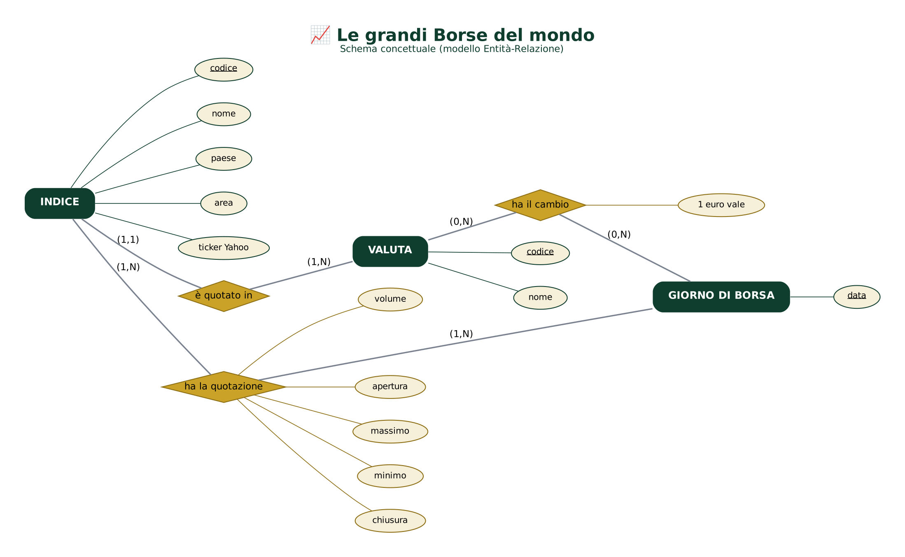
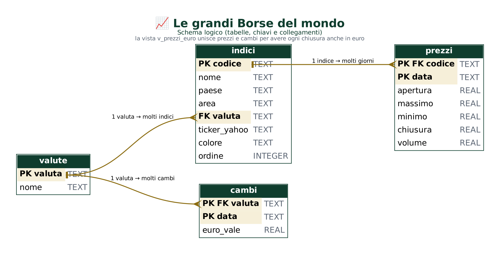

# 📈 Le grandi Borse del mondo: 9 indici a confronto

Progetto di **Francesco Autorino** – Data Analyst.

🛠️ Strumenti: **Python · SQL · Power BI**

📊 Dati: **58.846 giorni di Borsa** di **9 indici**, dal 2000 al **26 ottobre 2026**, e i cambi dell'euro.

⚠️ **Solo analisi storica**: il passato non dice nulla sul futuro. Non è un consiglio di investimento.

---

## 🧭 1. Il progetto in breve

❓ **La domanda**: come si sono comportate le principali Borse del mondo negli ultimi 20 anni?

| Indice | Paese | Valuta |
|---|---|---|
| 🇺🇸 S&P 500 | Stati Uniti | dollaro |
| 🇺🇸 Nasdaq 100 | Stati Uniti | dollaro |
| 🇪🇺 Euro Stoxx 50 | Eurozona | euro |
| 🇩🇪 DAX | Germania | euro |
| 🇫🇷 CAC 40 | Francia | euro |
| 🇮🇹 FTSE MIB | Italia | euro |
| 🇬🇧 FTSE 100 | Regno Unito | sterlina |
| 🇯🇵 Nikkei 225 | Giappone | yen |
| 🇭🇰 Hang Seng | Hong Kong | dollaro di Hong Kong |

Le 5 domande più piccole:

1️⃣ 🏆 Quale indice è cresciuto di più dal 2007 a oggi?

2️⃣ 💶 Cambia qualcosa se conto tutto in euro?

3️⃣ 🎢 Quale indice è più rischioso?

4️⃣ 📉 Quanto hanno perso nelle crisi e quanto ci hanno messo a recuperare?

5️⃣ 🔗 Le Borse si muovono insieme?

📅 Periodo dei confronti: dal **30 marzo 2007** (primo giorno dell'Euro Stoxx 50) al **26 ottobre 2026**.

---

## 🎯 2. I risultati principali

🏆 **Nasdaq 100 +1.552%** (×16) e **S&P 500 +440%**. In fondo **FTSE MIB +18%** e **Hang Seng +17%**.

💶 In **euro** gli indici americani vanno ancora meglio: il dollaro si è rafforzato del **19%**.
Il FTSE 100 invece scende da +71% a **+38%** (sterlina più debole).

🎢 Il più tranquillo è il **FTSE 100** (volatilità 17,8%). I più agitati: **Hang Seng** e **FTSE MIB** (24%).

📉 Il **2008** è stata la crisi peggiore: cadute da **−48%** a **−72%**.

⏳ Il **FTSE MIB** è tornato al picco del 2007 solo a **novembre 2025**: oltre **16 anni** dopo.

🦠 Dopo il **Covid** l'S&P 500 ha recuperato in **5 mesi**.

📅 Il **2008** e il **2018** sono stati negativi per **tutti** i 9 indici.

🔗 Le Borse europee si muovono quasi insieme (CAC 40 – Euro Stoxx 50: **0,97**). Le asiatiche sono le più "diverse".

⚠️ Il **DAX** conta anche i dividendi, gli altri indici no: per questo sembra più forte delle altre Borse europee.

---

## 🛠️ 3. Perché questi strumenti

🐍 **Python**: calcoli su 58.846 giorni (rendimenti, rischio, crisi, correlazioni) e grafici.

🗄️ **SQL**: i dati sono tabelle collegate (indici, prezzi, valute, cambi). Le query usano funzioni finestra: `LAG`, `ROW_NUMBER`, `RANK`, `MAX() OVER`, media mobile.

📊 **Power BI**: si sceglie l'area del mondo e si passa da **valuta locale** a **euro** con un clic.

---

## 🔄 4. Il percorso dei dati

```
Yahoo Finance            01_scarica.py            02_pulizia.py                   ANALISI
9 indici + 4 cambi ───► ❌ 83.890 righe ───────► ✅ 58.846 giorni di Borsa ──┬──► 🐍 Python
dal 2000                 (1GrezziNonPuliti)       + cambi, rendimenti,        ├──► 🗄️ SQL
                                                  crisi, correlazioni         └──► 📊 Power BI
```

🧹 **Cosa ho fatto durante la pulizia**

| Passo | Cosa | Risultato |
|---|---|---|
| 1 | Letti i dati di 9 indici e 4 cambi dal 2000 | 83.890 righe |
| 2 | Tolto il 27/10/2026: la giornata era ancora aperta | −11 righe |
| 3 | Controllati i doppioni | 0 |
| 4 | Cambi: tolti i picchi sbagliati (es. euro/dollaro a 1,49 l'8/12/2008, e il giorno dopo di nuovo 1,29) | −6 |
| 5 | Massimo e minimo del giorno sistemati per contenere apertura e chiusura | 58.846 giorni |
| 6 | Volumi a zero messi come vuoti (non servono ai calcoli) | 4.246 |
| 7 | Controllati i 15 giorni con variazioni oltre ±12%: sono veri (crisi 2008, Brexit, Covid, dazi 2025) | tenuti |
| 8 | Controllate le pause oltre 7 giorni: solo il Nikkei nel 2019 (10 giorni di festa per il nuovo imperatore) | tenuta |
| 9 | Chiusure convertite in euro con il cambio del giorno (o dell'ultimo giorno disponibile) | 55.166 |
| 10 | Calcolati base 100, distanza dal massimo, rendimenti annui, crisi e correlazioni | 7 tabelle |

🧮 **Le misure usate**

| Misura | Come si calcola |
|---|---|
| Crescita totale | ultimo valore ÷ valore del 30/03/2007 − 1 |
| Crescita media all'anno | (ultimo ÷ primo)^(1 ÷ anni) − 1 |
| Volatilità annua | deviazione standard dei rendimenti giornalieri × √252 |
| Caduta massima | la perdita più grande dal punto più alto al punto più basso |
| Recupero | quanto tempo serve per tornare al valore del picco |
| Correlazione | quanto si muovono insieme i rendimenti mensili (da 0 a 1) |

---

## 📁 5. I file in questo repository

| File | A cosa serve |
|---|---|
| `README.md` | Questo file |
| `DESCRIZIONE_GITHUB.md` | Nome, descrizione e topics del repository |
| `00_LEGGIMI.md` (in ogni cartella) | Una spiegazione corta di quella cartella |

### 📂 01Python

| File | A cosa serve |
|---|---|
| `01_analisi_borsa_mondiale.ipynb` | 📓 L'analisi completa con 8 grafici (si legge anche su GitHub) |
| `02_CONCLUSIONI.md` | ✅ Le risposte alle 5 domande |

### 📂 02SQL

| File | A cosa serve |
|---|---|
| `01_schema_concettuale.png` | 🧩 Lo schema concettuale (modello Entità-Relazione) |
| `02_schema_logico.png` | 🗂️ Lo schema logico: tabelle, chiavi PK/FK e collegamenti |
| `03_crea_database.sql` | 🏗️ Crea le tabelle `valute`, `indici`, `prezzi`, `cambi` e la vista `v_prezzi_euro` |
| `04_query_analisi.sql` | 🔍 **18 query** divise per domanda: LAG, ROW_NUMBER, RANK, MAX() OVER, media mobile, correlazione |

🧩 **Schema concettuale**



🗂️ **Schema logico**



### 📂 03PowerBi

| File | A cosa serve |
|---|---|
| `01_BorsaMondialeDashboard.zip` | ⭐ **La dashboard**: estrai lo zip e apri `BorsaMondiale_Dashboard.pbip` con Power BI Desktop |
| `02_BorsaMondiale_Dashboard.pdf` | 📄 La dashboard in PDF |
| `03_misure_DAX.txt` | 🧮 Le 19 misure DAX |

📊 **Le 6 pagine della dashboard**

1. **Panoramica**: 6 numeri chiave, la crescita di ogni indice dal 2007, la classifica
2. **La crescita**: valuta locale contro euro, crescita all'anno, la tabella con i record
3. **Il rischio**: rischio e crescita, la caduta più grande, quanto è sotto il massimo
4. **Le crisi**: cadute e mesi di recupero in 4 crisi (2000, 2008, Covid, 2022)
5. **Anno per anno**: si sceglie un indice e si vedono i suoi anni, verdi e rossi
6. **Conclusioni**

🎛️ In alto si sceglie l'**area** (America, Europa, Asia) e la **vista** (valuta locale o euro).
La scelta resta uguale su tutte le pagine.

---

## 📦 6. Dati e script

📌 Qui ci sono solo i **risultati**: analisi, query, schemi e dashboard.

📥 I dati si possono riscaricare dalla fonte (link più sotto).

🐍 Gli script Python di raccolta e pulizia dei dati e il database sono disponibili su richiesta.

---

## ⚠️ 7. Limiti

📌 Indici di **prezzo**: non contano i dividendi (tranne il **DAX**, che li include).

📌 Niente costi, commissioni e tasse.

📌 Il periodo scelto cambia i risultati: partire nel 2007, poco prima della crisi, penalizza tutti.

📌 L'Euro Stoxx 50 è disponibile solo dal 30 marzo 2007.

📌 Dati Yahoo Finance: sono dati di mercato, non una fonte ufficiale delle Borse.

📌 Solo analisi storica: **non** è un consiglio di investimento.

---

## 🔗 8. Da dove arrivano i dati (link)

| Fonte | Cosa ho preso | Link |
|---|---|---|
| Yahoo Finance | Prezzi giornalieri dei 9 indici e dei 4 cambi dell'euro, dal 2000 | https://finance.yahoo.com/markets/world-indices/ |
| Yahoo Finance – endpoint "chart" | L'indirizzo usato da `01_scarica.py` (un ticker alla volta) | https://query1.finance.yahoo.com/v8/finance/chart/%5EGSPC?period1=946684800&interval=1d |

| Ticker Yahoo | Indice |
|---|---|
| `^GSPC` · `^NDX` | S&P 500 · Nasdaq 100 |
| `^STOXX50E` · `^GDAXI` · `^FCHI` · `FTSEMIB.MI` · `^FTSE` | Euro Stoxx 50 · DAX · CAC 40 · FTSE MIB · FTSE 100 |
| `^N225` · `^HSI` | Nikkei 225 · Hang Seng |
| `EURUSD=X` · `EURGBP=X` · `EURJPY=X` · `EURHKD=X` | i cambi dell'euro |

📅 Dati scaricati il **27 ottobre 2026** (ultimo giorno completo: 26 ottobre 2026).

---

## 🪜 9. Tutti i passaggi fatti, in ordine

1️⃣ **Scelta del progetto**: 9 indici delle grandi Borse di America, Europa e Asia.

2️⃣ **Domande**: ho fissato le 5 domande e il periodo (dal 2007, per avere tutti gli indici).

3️⃣ **Raccolta** (`01_scarica.py`): prezzi giornalieri dal 2000 e cambi dell'euro.

4️⃣ **Controllo**: giornata ancora aperta, errori nei cambi, giorni con grandi variazioni, pause.

5️⃣ **Pulizia** (`02_pulizia.py`): conversione in euro, base 100, distanza dal massimo, rendimenti annui, crisi, correlazioni.

6️⃣ **Python**: notebook con 8 grafici e le conclusioni.

7️⃣ **SQL**: schema concettuale e logico, database SQLite con 4 tabelle e una vista, 18 query provate.

8️⃣ **Power BI**: dashboard di 6 pagine con pulsanti per area e valuta, aperta e controllata in Power BI Desktop.

9️⃣ **PDF**: esportata la dashboard in `BorsaMondiale_Dashboard.pdf`.

🔟 **Conclusioni**: risposte alle 5 domande e limiti.
